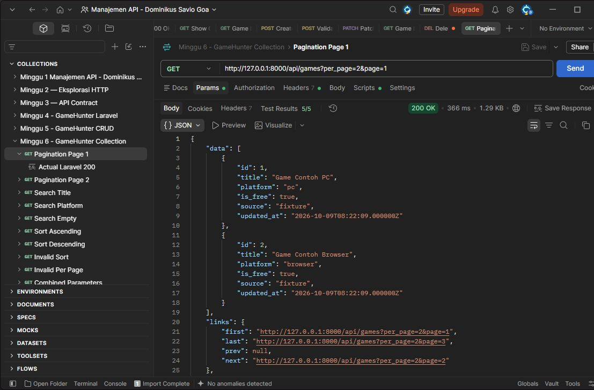
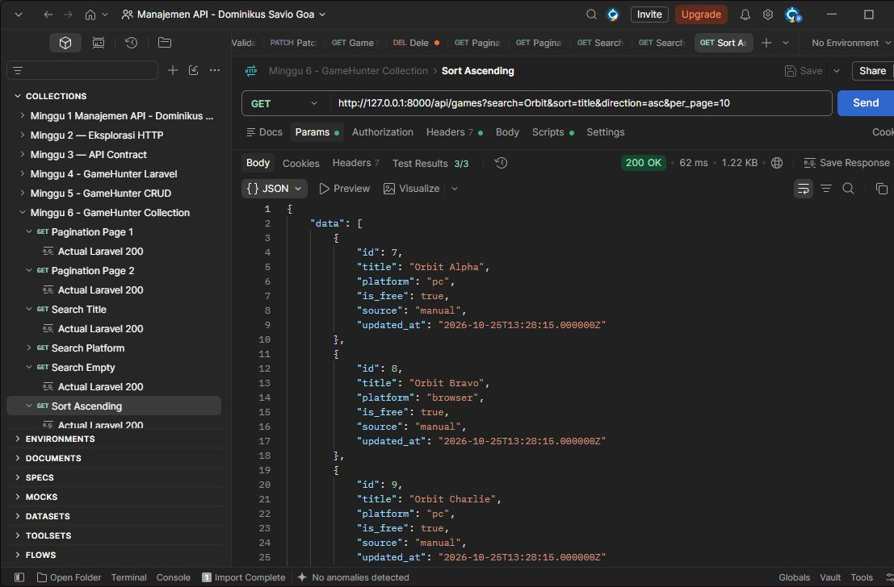
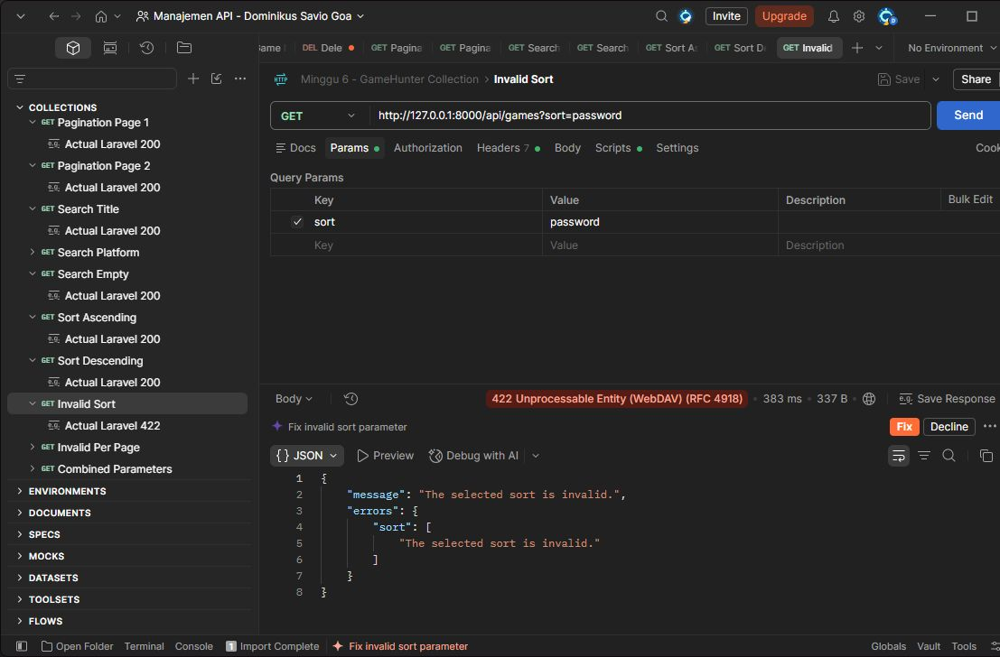
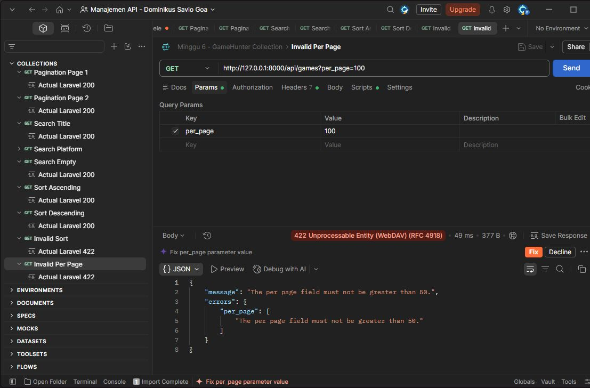
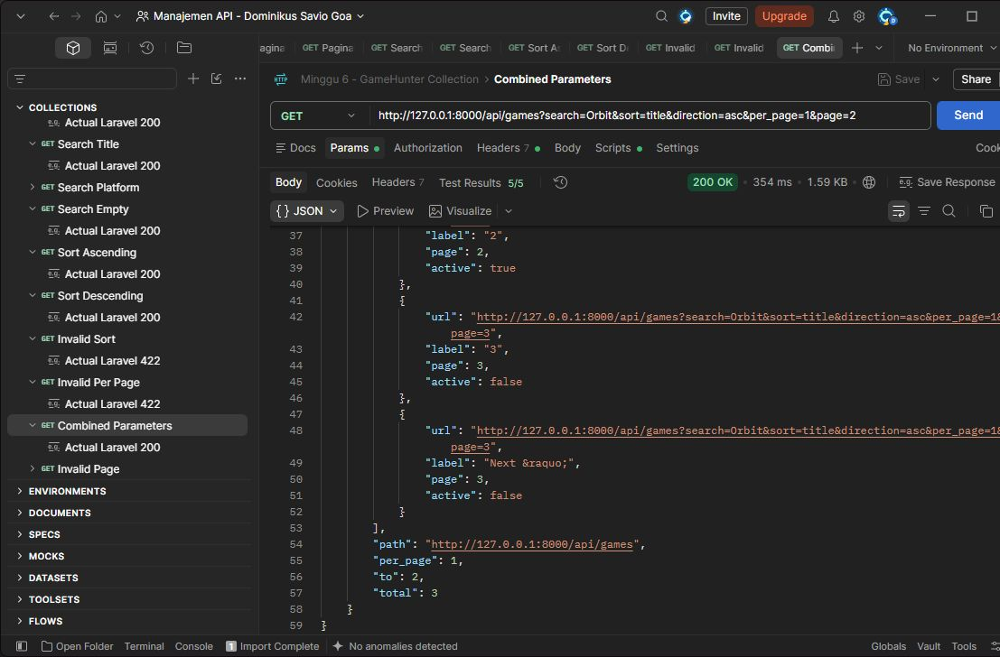

# Praktikum Minggu 6 — Search, Sorting, dan Pagination GameHunter

## Tujuan dan perubahan

Saya melanjutkan CRUD GameHunter agar daftar game bisa dicari, diurutkan, dan dibagi per halaman. Perubahan utama ada pada `index()` di `GameController`. Relasi belum ditambahkan karena praktikum ini fokus pada collection.

## Query Contract

Endpoint: `GET http://127.0.0.1:8000/api/games`. Gunakan header `Accept: application/json` dan No Auth.

| Parameter | Ketentuan |
| --- | --- |
| search | Sebagian judul atau platform, maksimal 100 karakter; boleh kosong |
| platform | Filter tepat `pc` atau `browser`, opsional |
| sort | `id`, `title`, `platform`, atau `created_at`; default `id` |
| direction | `asc` atau `desc`; default `asc` |
| page | Bilangan bulat minimal 1; default 1 |
| per_page | Bilangan bulat 1–50; default 5 |

Parameter di luar contract ditolak dengan `422`. Contoh buku pada materi disesuaikan menjadi game, sehingga pencarian ISBN diganti dengan platform.

## Verification

Diuji pada 25 Oktober 2026 dengan lima game, termasuk Orbit Alpha, Orbit Bravo, dan Orbit Charlie. Koleksi Postman Minggu 6 menyimpan 11 request beserta contoh respons aktual.

| Pengujian | Hasil aktual |
| --- | --- |
| `?per_page=2&page=1` | 200, ID 1 dan 2; total 5 |
| `?per_page=2&page=2` | 200, ID 7 dan 8; halaman berbeda |
| `?search=Orbit` | 200, tiga judul Orbit ditemukan |
| `?search=browser` | 200, dua game sesuai platform/judul |
| `?search=tidak-ada-987654321` | 200, `data: []`, total 0 |
| `?search=Orbit&sort=title&direction=asc&per_page=10` | 200, Alpha → Bravo → Charlie |
| Parameter sama, `direction=desc` | 200, Charlie → Bravo → Alpha |
| `?sort=password` | 422, `errors.sort` |
| `?per_page=100` | 422, `errors.per_page` |
| `?page=0` | 422, `errors.page` |
| `?search=Orbit&sort=title&direction=asc&per_page=1&page=2` | 200, Orbit Bravo; link tetap membawa query |

Hasil otomatis: **74 test Laravel dengan 245 assertion lulus**. Koleksi Postman dijalankan melalui Newman: **11 request dan 38 assertion lulus**, tanpa kegagalan. Pemeriksaan mencakup CRUD lama, gabungan filter, pencarian `0`, batas input, dan perpindahan halaman.

Untuk mengulang, jalankan `php artisan serve`, lalu kirim URL pengujian di atas melalui Postman. Tes Laravel dijalankan dengan `php artisan test --compact`.

### Bukti Postman

Pagination halaman 1 dan 2:




Pencarian ditemukan dan tanpa hasil:


Sorting A–Z dan Z–A:




Parameter salah:





Gabungan parameter dan informasi pagination:




## Response Structure

`data` berisi game pada halaman aktif. Setiap game tetap memiliki `id`, `title`, `platform`, `is_free`, `source`, dan `updated_at`. `links` menyediakan URL navigasi. `meta` memuat halaman aktif, ukuran halaman, halaman terakhir, dan total hasil.

Pencarian tanpa hasil tetap `200` dengan array kosong. Input tidak valid menghasilkan JSON `422`, misalnya:

```json
{
  "message": "The selected sort is invalid.",
  "errors": {
    "sort": ["The selected sort is invalid."]
  }
}
```

## Decision dan kesimpulan

Sorting memakai allowlist agar nama kolom dari pengguna tidak langsung masuk ke query. Urutannya: validasi → filter → sorting → pagination → GameResource. ID menjadi urutan tambahan saat nilai sorting sama. `withQueryString()` menjaga parameter pada link halaman berikutnya.

Collection GameHunter sudah mendukung pencarian, filter, sorting, dan pagination dengan respons konsisten. Implementasi dan koleksi pengujian tersimpan di project lokal; repository pengumpulan berisi laporan dan gambar.

## Referensi

- Materi 6 dan Praktikum 6 dari dosen.
- [Laravel 13 — Pagination](https://laravel.com/framework/docs/13.x/pagination)
- [Laravel 13 — API Resources](https://laravel.com/framework/docs/13.x/eloquent-resources)
- [Laravel 13 — Validation](https://laravel.com/framework/docs/13.x/validation)

## Deklarasi penggunaan AI

AI membantu saya dalam praktikum dan langkah pengerjaan saat ada kendala.
